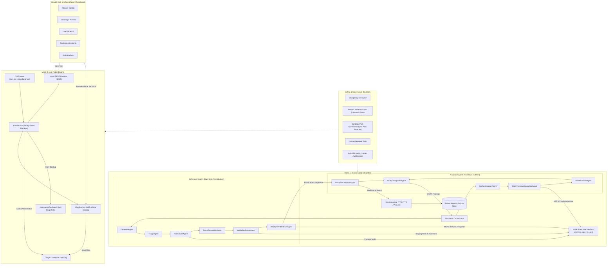
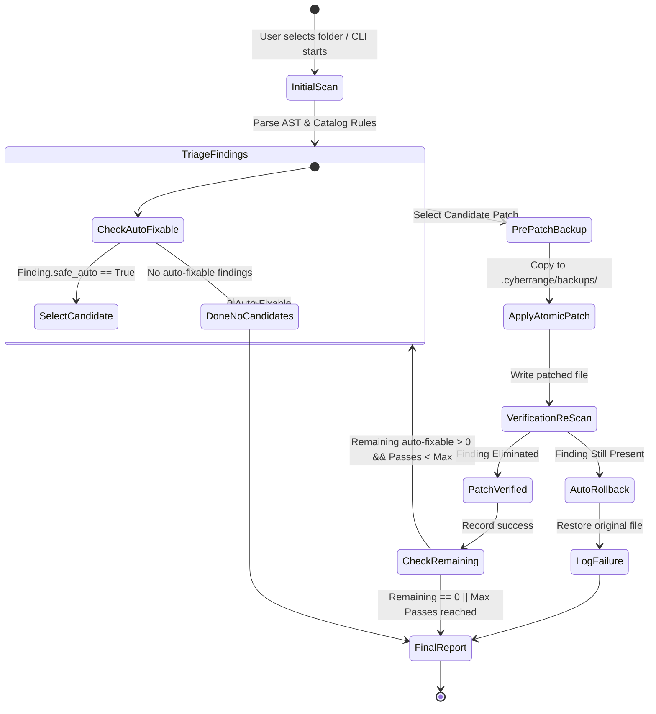

# System Architecture Specification

## 1. High-Level Architectural Design

The **Defensive Cyber Range Simulation Platform** (Citadel) is structured around two coordinated operational paradigms:

1. **Closed-Loop Synthetic Simulation (Mode 1)**: Multi-agent swarms operate inside an ephemeral, strictly isolated mock enterprise environment, executing an automated audit → triage → patch → test → verify loop managed by a central orchestrator.
2. **Live Folder Vulnerability Remediation (Mode 2)**: A safety-gated AST and pattern-based analysis engine scans a designated local project directory, identifies vulnerabilities against a catalog of 16 security rules, generates minimal deterministic patches, and applies fixes in a verified multi-pass loop with automatic rollback protection.

---

## 2. Multi-Agent Swarm Specifications

### Security Analysis Swarm (`agents/analysis_swarm.py`)
Non-destructive static analysis and compliance auditing agents that operate on abstract syntax trees without producing weaponized exploits:

| Agent | Responsibility | Primary Input | Primary Output |
| :--- | :--- | :--- | :--- |
| **`SurfaceMapperAgent`** | Scans Python AST across target workspace to identify public endpoints, functions, parameters, and route decorators. | Source files | `list[EndpointSurface]` |
| **`StaticVulnerabilityAuditorAgent`** | Traverses AST nodes to detect CWE-89, CWE-862, CWE-79, and CWE-489 patterns. | `EndpointSurface` | `list[SecurityFinding]` |
| **`RiskPrioritizerAgent`** | Calculates CVSS-aligned risk scores based on exploitability factors and exposure. | `list[SecurityFinding]` | Sorted `list[SecurityFinding]` |
| **`ComplianceVerifierAgent`** | Independent re-auditor that tests patched files against security invariants after defensive deployment. | Patched files, Findings | `VerificationResult` |
| **`AnalysisReporterAgent`** | Consolidates findings and verifications into standardized SARIF/JSON summaries. | Findings, Verifications | `AnalysisRoundReport` |

### Defensive Response Swarm (`agents/defense_swarm.py`)
Automated blue team agents that detect, triage, patch, test, and deploy verified fixes:

| Agent | Responsibility | Primary Input | Primary Output |
| :--- | :--- | :--- | :--- |
| **`DetectionAgent`** | Correlates incoming telemetry logs and static audit findings into actionable security alerts. | Telemetry events, Findings | `list[SecurityAlert]` |
| **`TriageAgent`** | Deduplicates alerts, normalizes CWE classes, and sets remediation SLAs. | `list[SecurityAlert]` | `list[TriagedIncident]` |
| **`RootCauseAgent`** | Analyzes the AST around reported line numbers to identify the exact vulnerable node and transformation contract. | `TriagedIncident` | `RootCauseAnalysis` |
| **`PatchGenerationAgent`** | Synthesizes a minimal, clean unified diff to satisfy the remediation contract. | `RootCauseAnalysis` | `CandidatePatch` |
| **`ValidationTestingAgent`** | Applies patch in isolated staging sandbox and executes functional unit tests plus regression checks. | `CandidatePatch` | `ValidationReport` |
| **`DeploymentRollbackAgent`** | Verifies safety gates, records pre-patch SHA-256 digest, atomically swaps patched file, and rolls back if post-deployment checks fail. | `CandidatePatch`, `ValidationReport` | `DeploymentReceipt` |

---

## 3. Live Folder Mode Architecture

### Core Design Rules
- **Approved Roots Only**: Scans and writes are strictly restricted to paths explicitly whitelisted at service launch.
- **Zero Execution**: No target code is executed; all analysis is static AST traversal or regular-expression pattern matching.
- **Secret Redaction**: Credentials and sensitive values are redacted in evidence logs and API responses.
- **Optimistic File Locking**: Before applying any patch, the file's current SHA-256 checksum is compared against the scan-time digest. If the file was modified concurrently, the patch is rejected.
- **Automatic Snapshot & Revert**: Prior to modifying a file, a copy is archived to `.cyberrange/backups/<timestamp>/`. If post-patch verification fails, the original content is restored automatically.

### Closed-Loop Multi-Pass Remediation State Machine

---

## 4. Shared Memory & Quantitative Scoring

Cross-round memory is maintained in SQLite (`simulation_memory.db`) with tables for `rounds`, `findings_history`, and `patches_ledger`:
- Prevents repeating patch strategies that failed validation in previous rounds.
- Evaluates quantitative performance:
  - **Mean Time to Detect (MTTD)**: Average milliseconds elapsed before finding discovery.
  - **Mean Time to Remediate (MTTR)**: Milliseconds from incident triage to verified patch deployment.
  - **Patch Correctness Rate**: Verified remediations / Total deployed patches.
  - **Regression Pass Rate**: Staging test passes / Total validation runs.
  - **Security Posture Score**: Weighted percentage of remediated vs open vulnerability classes.
