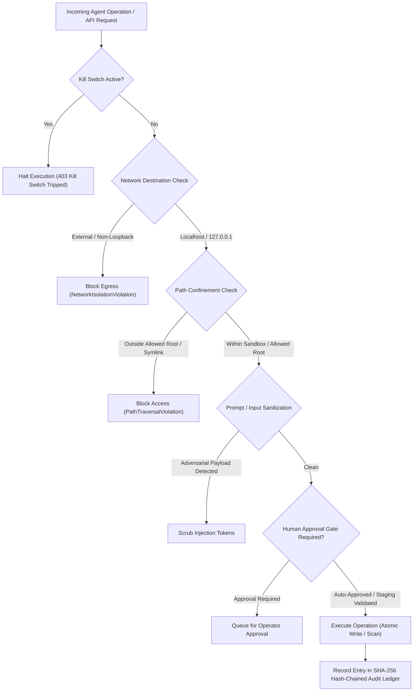

# Safety Controls & Isolation Governance

Citadel operates under a comprehensive defense-in-depth safety architecture designed to prevent unauthorized system mutation, network egress, and accidental data exposure during both simulation runs and live codebase remediations.

---

## 1. Safety Controls Architecture

---

## 2. Core Governance Mechanisms

### A. Emergency Kill Switch (`KillSwitch`)
- Provides immediate global halting capability.
- When tripped via CLI, API, or UI, all pending agent tasks are aborted instantly.
- Preserves existing sandbox files, test logs, and audit ledgers in place so forensic state is never lost.
- Can only be reset through an explicit operator action.

### B. Network Isolation Guard (`NetworkIsolationGuard`)
- Enforces strict socket boundaries.
- Whitelists only local loopback hosts (`127.0.0.1`, `localhost`, `::1`).
- Intercepts and blocks any outbound socket connection or HTTP request destined for public IPs or remote networks.

### C. Sandbox Path Confinement (`SandboxPathConfinement`)
- Normalizes all paths against canonical workspace boundaries.
- Forbids path traversal patterns (`../`, `..\\`).
- Refuses to follow symbolic links targeting directories outside the designated root.
- Protects sensitive system files (e.g., `.git`, `.env`, `id_rsa`) from being read or reported verbatim.

### D. Human Approval Gate (`HumanApprovalGate`)
- Configurable approval policies: `AUTOMATIC`, `CONFIRM_DEPLOY`, or `MANUAL_EVERY_STEP`.
- In `CONFIRM_DEPLOY` mode, candidate patches synthesized by Blue agents can only be deployed to the active target workspace after explicit human sign-off in the UI or CLI.

### E. Tamper-Evident SHA-256 Audit Ledger (`ImmutableAuditLogger`)
- Every agent invocation, parameter set, tool call, and patch checksum is sealed into an immutable sequence of audit entries.
- Each entry references the cryptographic hash of the preceding entry:
  $$\text{EntryHash}_n = \text{SHA256}(\text{Index}_n \parallel \text{Timestamp}_n \parallel \text{Actor}_n \parallel \text{Action}_n \parallel \text{Payload}_n \parallel \text{EntryHash}_{n-1})$$
- The entire chain can be cryptographically verified at any moment to guarantee no historical records were altered or deleted.

### F. Optimistic Concurrency & Automatic Rollback
- Every write in Live Folder Mode is guarded by a dual-hash verification:
  1. File checksum at scan time must equal file checksum immediately prior to write.
  2. A pre-patch backup is stored in `.cyberrange/backups/<timestamp>/`.
  3. If post-patch verification fails, the original content is atomically restored.
