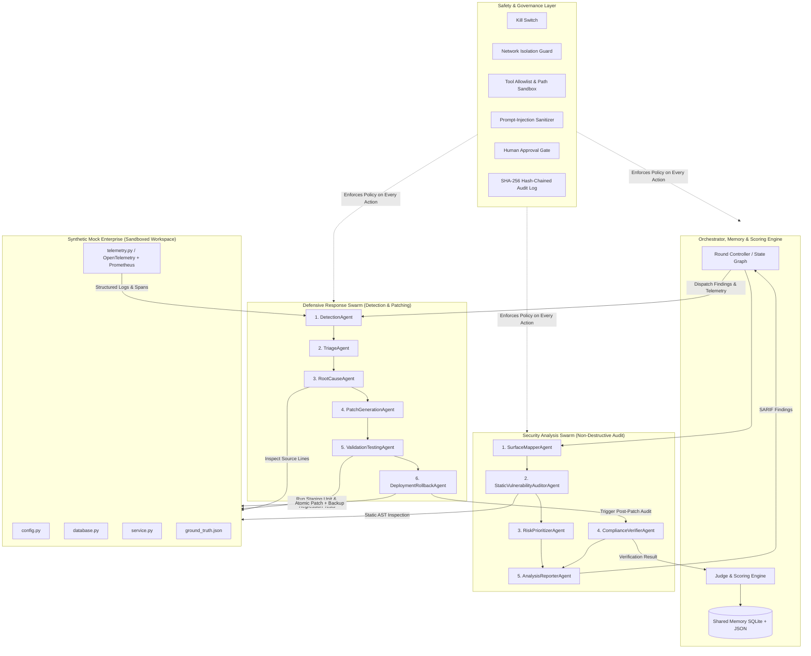

# System Architecture & Multi-Agent Design

## 1. High-Level Overview

The **Defensive Cyber Range Simulation Platform** implements a closed-loop cyber resilience architecture in which two specialized multi-agent teams operate inside a strictly isolated workspace managed by a central Orchestrator, Judge, and Safety Controller:

1. **Security Analysis Swarm (Red-Style Static & Architectural Auditors)**: Maps application surfaces, performs AST and pattern-based source code auditing, evaluates risk severity, and verifies post-patch compliance—without generating or executing weaponized payloads.
2. **Defensive Response Swarm (Blue-Style Detection & Automated Remediation Agents)**: Correlates telemetry and audit findings, triages incidents, pinpoints vulnerable AST nodes, synthesizes minimal security patches, validates fixes against functional and security test suites in a staging directory, and deploys verified patches with cryptographic rollback protection.

## 2. Agent Role Definitions

### Security Analysis Swarm (`agents/analysis_swarm.py`)

| Agent | Role | Inputs | Outputs |
| :--- | :--- | :--- | :--- |
| `SurfaceMapperAgent` | Parses Python AST across the target workspace to inventory functions, API endpoints, parameters, and authentication decorators. | Workspace path | ` list[EndpointSurface] ` |
| `StaticVulnerabilityAuditorAgent` | Performs AST traversal and structural pattern inspection to detect CWE-89 (unparameterized SQL formatting), CWE-862 (missing role check on admin endpoints), CWE-79 (unescaped HTML template rendering), and CWE-489/CWE-209 (debug/secret exposure). | Workspace path, `EndpointSurface` list | `list[SecurityFinding]` |
| `RiskPrioritizerAgent` | Calculates deterministic CVSS-aligned severity scores and remediation priority order based on exploitability factors and exposure. | `list[SecurityFinding]` | Ranked `list[SecurityFinding]` |
| `ComplianceVerifierAgent` | Re-audits patched files and runs non-destructive security invariant checks after Blue Swarm deployment to confirm the vulnerability is remediated. | Patched workspace path, `SecurityFinding` | `VerificationResult` |
| `AnalysisReporterAgent` | Packages findings and verification outcomes into standardized JSON/SARIF reports and records telemetry events. | Findings, `VerificationResult` | `AnalysisRoundReport` |

### Defensive Response Swarm (`agents/defense_swarm.py`)

| Agent | Role | Inputs | Outputs |
| :--- | :--- | :--- | :--- |
| `DetectionAgent` | Monitors structured application telemetry logs and incoming static analysis reports to generate actionable security alerts. | Telemetry stream, `SecurityFinding` list | `list[SecurityAlert]` |
| `TriageAgent` | Deduplicates alerts, maps each alert to a canonical CWE and target file, and assigns SLA remediation targets. | `list[SecurityAlert]` | `list[TriagedIncident]` |
| `RootCauseAgent` | Inspects the target source file and AST around the reported line numbers to extract the exact vulnerable code block and required remediation contract. | `TriagedIncident`, source file | `RootCauseAnalysis` |
| `PatchGenerationAgent` | Synthesizes a minimal, well-typed code replacement and unified diff to remediate the root cause (supports LLM-assisted synthesis via `LLMAdapter` with deterministic AST/template fallback). | `RootCauseAnalysis` | `CandidatePatch` |
| `ValidationTestingAgent` | Applies `CandidatePatch` in an isolated staging copy and runs the full functional unit test suite plus static security assertions to ensure zero regressions. | `CandidatePatch`, staging workspace | `ValidationReport` |
| `DeploymentRollbackAgent` | Checks safety/human approval gates, snapshots the original file (with SHA-256 digest), applies the validated patch atomically, and rolls back automatically if post-deployment checks fail. | `CandidatePatch`, `ValidationReport` | `DeploymentReceipt` |

## 3. Communication & Shared Memory Model

All agents communicate through typed immutable dataclasses (`agents/models.py`) coordinated by `SimulationOrchestrator` (`orchestrator/engine.py`). Cross-round state is persisted in `SharedMemoryStore` (`orchestrator/memory.py`) backed by SQLite (`simulation_memory.db`):

- **`rounds` table**: Tracks round number, timestamps, initial finding count, remediated count, and overall posture score.
- **`findings_history` table**: Stores every discovered CWE, file path, line number, severity, and remediation status across rounds.
- **`patches_ledger` table**: Records unified diffs, validation test results, deployment hashes, rollback events, and lessons learned so agents avoid repeating failed patch strategies.

## 4. Closed-Loop Round Lifecycle

1. **Workspace Initialization**: The orchestrator clones `mock_enterprise/` into an isolated working sandbox (`simulation_artifacts/workspace/`) so original template files are never mutated directly.
2. **Phase 1 — Surface Mapping & Static Audit**: The Analysis Swarm inspects the sandboxed codebase and emits structured `SecurityFinding` objects.
3. **Phase 2 — Telemetry Correlation & Triage**: The Defense Swarm correlates findings with application telemetry spans and prioritizes incidents.
4. **Phase 3 — Root-Cause Isolation & Patch Synthesis**: For each incident, `RootCauseAgent` isolates the vulnerable snippet and `PatchGenerationAgent` creates a `CandidatePatch` with a unified diff.
5. **Phase 4 — Staging Validation & Atomic Deployment**: `ValidationTestingAgent` verifies all functional and security unit tests pass in a temporary staging copy before `DeploymentRollbackAgent` applies the patch to the active sandbox.
6. **Phase 5 — Independent Compliance Verification**: `ComplianceVerifierAgent` re-audits the patched codebase to confirm the vulnerability is eliminated.
7. **Phase 6 — Scoring & Memory Consolidation**: `ScoringEngine` compares discoveries against `ground_truth.json`, calculates TTD, TTR, Patch Correctness, and Resilience Score, and writes reports.
